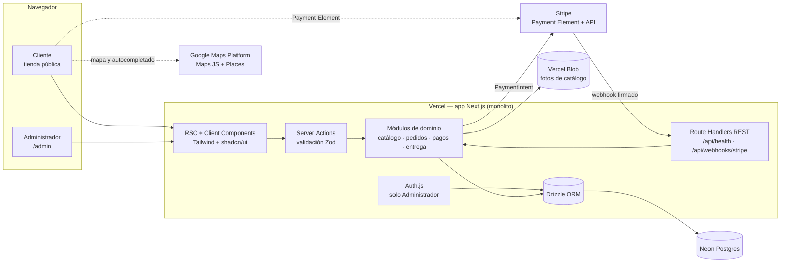
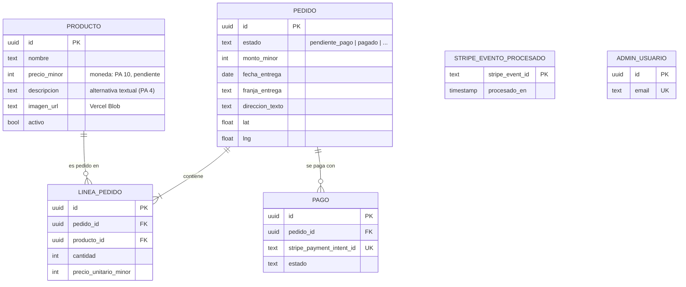
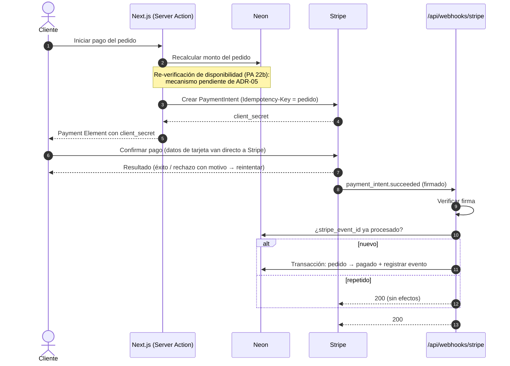
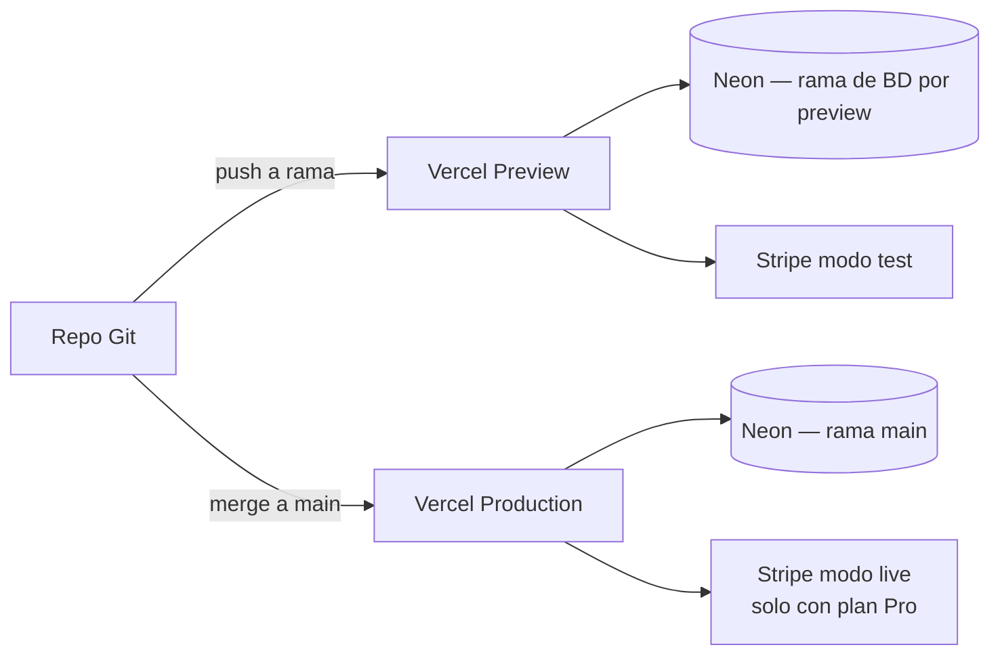

# Technical Design Document — E-commerce de Florería

> Proyecto: `floreria-ecommerce/`. Fecha: 2026-10-13. Autor: rol ARCH (encargo del LEAD).
> Insumos: `PRD.md` (Ronda 2 — Convergencia), HU-05..HU-08 (`docs/historias-usuario/`), WF-05..WF-08 (`docs/ux/wireframes/`), ADR-01..ADR-06 (`docs/adr/`).
> **Modo de elaboración:** manual. Las skills `generar-tech-design` y `archify` no estaban instaladas y el humano eligió avanzar sin ellas. Cada decisión se tomó en entrevista con el humano. Los diagramas están en Mermaid dentro de este documento y **no se generaron con `archify`**: pueden regenerarse con más detalle si se instala después.

---

## 1. Contexto

**Problema (PRD §1):** hoy, comprar flores requiere llamadas o WhatsApp para consultar disponibilidad, precio y horarios. El cliente no tiene certeza de disponibilidad ni puede gestionar la compra y la entrega desde un solo lugar.

**Objetivo del MVP (PRD §3.1):** consultar el catálogo, verificar la disponibilidad de producto, fecha y horario, registrar pedidos, pagar con Stripe y seleccionar la dirección de entrega en un mapa. Actores: **Cliente** y **Administrador** (PRD §2).

**Criterios de éxito que condicionan la arquitectura (PRD §4):** compra autónoma en < 5 min (rendimiento, poca fricción), disponibilidad confiable (consistencia de stock: ver ADR-05, BLOQUEADO), 90 % de entregas en horario (dirección precisa con coordenadas: ADR-04) y gestión completa de pedidos desde el sistema (backoffice).

## 2. Contexto de ecosistema

| Aspecto | Valor | Fuente |
|---|---|---|
| Greenfield / brownfield | **Greenfield en código** (no hay código previo), **con decisiones previas** que respetar (ADR-01..06). | Inspección del repo, 2026-10-13 |
| Lenguaje del equipo | TypeScript / JavaScript | Humano, 2026-10-13 |
| Hosting | Vercel | Humano, 2026-10-06 |
| Presupuesto | **Solo planes gratuitos** para el MVP | Humano, 2026-10-13 |

## 3. Resumen de decisiones

| # | Área | Decisión | ADR | Estado |
|---|---|---|---|---|
| D-A1 / D-C1 | Componentes, API y estado | Monolito **Next.js (App Router)**. RSC para lecturas, Server Actions (con validación Zod) para mutaciones y Route Handlers REST solo para URL estables. | [ADR-07](docs/adr/ADR-07-arquitectura-monolito-nextjs.md) | `ACEPTADO` |
| D-A3 / D-C3 | Hosting y runtime | **Vercel**: Hobby para desarrollo, previews y demo, y **Pro obligatorio antes de cobrar a clientes reales**. Node 22 LTS y pnpm. | [ADR-08](docs/adr/ADR-08-hosting-vercel-runtime.md) | `ACEPTADO` (condición de salida a producción) |
| D-A2 / D-B1 | Datos | **Neon Postgres** (plan gratis) con **Drizzle ORM** y migraciones con drizzle-kit. | [ADR-09](docs/adr/ADR-09-base-datos-neon-drizzle.md) | `ACEPTADO` |
| D-B2 | Pruebas | **Vitest** (unitarias e integración) y **Playwright** con **axe** (punta a punta y accesibilidad). | [ADR-10](docs/adr/ADR-10-pruebas-vitest-playwright.md) | `ACEPTADO` |
| D-B3 | Autenticación del Administrador | **Auth.js (NextAuth v5)** con sesiones en Neon. El acceso del Cliente sigue en ADR-06 (BLOQUEADO). | [ADR-11](docs/adr/ADR-11-autenticacion-administrador.md) | `ACEPTADO` |
| D-C2 | UI | **Tailwind CSS + shadcn/ui** (Radix), mobile-first y accesible. | [ADR-12](docs/adr/ADR-12-ui-tailwind-shadcn.md) | `ACEPTADO` |
| D-B4 | Mapa y autocompletado | **Google Maps Platform** (Maps JS + Places Autocomplete). Complementa ADR-04. | [ADR-13](docs/adr/ADR-13-proveedor-mapas-google.md) | `ACEPTADO` |
| D-C4 | Imágenes del catálogo | **Vercel Blob** con `next/image`. | [ADR-14](docs/adr/ADR-14-imagenes-vercel-blob.md) | `ACEPTADO` |
| D-D1 | Resiliencia de pagos | El estado "pagado" se fija **solo vía webhook firmado** de Stripe, con idempotencia al crear el PaymentIntent y al procesar eventos. Complementa ADR-03. | [ADR-15](docs/adr/ADR-15-resiliencia-pagos-webhook.md) | `ACEPTADO` |
| — | Inventario | Sin decisión de modelo. | [ADR-05](docs/adr/ADR-05-inventario-disponibilidad.md) | `BLOQUEADO` (D4) — **no tocado** |
| — | Acceso del Cliente | Sin decisión. | [ADR-06](docs/adr/ADR-06-acceso-cliente-checkout.md) | `BLOQUEADO` (D6) — **no tocado** |

## 4. Componentes

Una sola aplicación Next.js desplegada en Vercel. Las zonas lógicas son módulos dentro del mismo código, no servicios separados.

**Reglas de dependencia:**
- La UI no accede a la base de datos directamente: pasa por Server Actions o RSC, que llaman a los módulos de dominio.
- Los módulos de dominio no dependen de Next.js (funciones TypeScript puras más Drizzle), así se pueden probar con Vitest sin levantar el servidor.
- Las rutas `/admin/**` y las Server Actions de administración exigen una sesión de Auth.js.

## 5. Modelo de datos (conceptual)

Solo contiene **entidades respaldadas por un insumo confirmado**. Lo que depende de una decisión abierta aparece marcado y no se diseña.

**Notas:**
- **Montos en unidades menores** (`*_minor`, enteros) para evitar errores de punto flotante. La moneda e impuestos siguen pendientes (PA 10).
- **Coordenadas en el pedido** (lat/lng más texto): requisito de ADR-04.
- **Stock y reservas: no se modelan.** Dependen de ADR-05 (D4, BLOQUEADO). Previsión sin compromiso: la elección de Postgres permite decrementos condicionales atómicos y `SELECT … FOR UPDATE`, que cualquier opción de D4 necesitaría.
- **Zona de cobertura:** ADR-04 sugiere polígonos configurables. No se modela hasta que se resuelva PA 14.
- **Identidad del Cliente: no se modela.** Depende de ADR-06 (D6, BLOQUEADO). El `PaymentIntent` va asociado al **pedido**, no a una cuenta (ADR-06 / ADR-15).
- Las tablas de Auth.js (`accounts`, `sessions`, `verification_tokens`) se agregan con su adaptador oficial de Drizzle y solo dan servicio a `ADMIN_USUARIO`.

## 6. Contratos

### 6.1 Endpoints HTTP (Route Handlers)

| Método y ruta | Propósito | Respuesta |
|---|---|---|
| `GET /api/health` | Verificación de salud (Sprint 0) | `200 {"status":"ok","db":"ok"}` si la app responde y la consulta `SELECT 1` a Neon funciona; `503 {"status":"error","db":"error"}` si falla la base de datos. |
| `POST /api/webhooks/stripe` | Recepción de eventos de Stripe (HU-07) | `200` cuando el evento se procesó o ya estaba procesado; `400` si la firma no es válida. Ver §7. |

### 6.2 Server Actions

Se definen por historia, no en el Sprint 0. Convención: cada acción valida su entrada con un esquema Zod, devuelve `{ ok: true, data } | { ok: false, error }` y nunca confía en precios o montos enviados por el cliente (los recalcula en el servidor).

### 6.3 Variables de entorno

| Variable | Uso | Sprint 0 |
|---|---|---|
| `DATABASE_URL` | Conexión a Neon | Sí |
| `AUTH_SECRET` | Firma de sesiones de Auth.js | No (cuando se implemente el login del admin) |
| `STRIPE_SECRET_KEY`, `NEXT_PUBLIC_STRIPE_PUBLISHABLE_KEY`, `STRIPE_WEBHOOK_SECRET` | Pagos | No (HU-07) |
| `NEXT_PUBLIC_GOOGLE_MAPS_API_KEY` | Mapa y autocompletado (clave restringida por dominio) | No (HU-08) |
| `BLOB_READ_WRITE_TOKEN` | Vercel Blob | No (HU-05) |

## 7. Flujo de pago y resiliencia (ADR-03 + ADR-15)

- La redirección del navegador **no** marca el pedido como pagado: solo informa al cliente. La fuente de verdad es el webhook.
- Si el cliente reintenta (HU-07 AC 3), se reutiliza el PaymentIntent del pedido gracias a la clave idempotente, así no hay cobros duplicados.

## 8. Despliegue

- **Entornos:** local (`pnpm dev` con Neon de desarrollo), Preview (por rama) y Production.
- **Neon:** se puede usar el *branching* de base de datos para las previews mediante la integración con Vercel, dentro del plan gratis.
- **Condición de salida a producción (ADR-08):** Stripe en modo live, y por lo tanto el cobro a clientes reales, solo con Vercel **Pro**. Mientras siga en Hobby, Stripe se usa solo en modo test.
- **Migraciones:** `drizzle-kit` genera SQL versionado en el repo, que se aplica de forma explícita, no automática en cada build.

## 9. Manejo de estado

- **Servidor como fuente de verdad:** catálogo, disponibilidad, pedido y pago se leen en RSC y se modifican con Server Actions o con el webhook.
- **Cliente:** solo estado efímero de UI (formularios, mapa, Payment Element). No hay librería global de estado.
- **Carrito:** su persistencia (entre sesiones o atada a una cuenta) **depende de D6** (ADR-06) y queda sin definir. El Sprint 0 no lo incluye.

## 10. Pruebas (ADR-10)

| Nivel | Herramienta | Qué cubre |
|---|---|---|
| Unitarias | Vitest | Módulos de dominio y esquemas Zod |
| Integración | Vitest con Postgres real (rama Neon de pruebas o Postgres local) | Repositorios Drizzle y transacciones |
| Punta a punta | Playwright | Flujos de HU-05..08 en navegador; Stripe en modo test |
| Accesibilidad | `@axe-core/playwright` | PA 19, 19b, 30: sin violaciones *serious* o *critical* |

## 11. Requisitos transversales

- **Accesibilidad:** componentes Radix/shadcn; no sobrescribir el foco ni los errores del Payment Element (PA 30); alternativa textual al mapa (ADR-04).
- **Rendimiento (Criterio 2):** mobile-first, `next/image` con lazy loading y catálogo renderizado en el servidor.
- **Seguridad:** las tarjetas nunca tocan el servidor (ADR-03); la clave de Maps se restringe por dominio; los secretos solo van en variables de entorno de Vercel; `/admin` está protegido por Auth.js.

## 12. Puntos abiertos vigentes

| Punto | Impacto | Responsable |
|---|---|---|
| D4 / ADR-05: modelo de inventario | Sin stock ni reservas; HU-06 AC 4 no implementable | Negocio / PM |
| D6 / ADR-06: registro o invitado | Sin carrito persistente ni flujo previo al pago | Negocio / PM |
| PA 10: moneda e impuestos | Formato de montos; Stripe `currency` | Negocio / PM |
| PA 14: cobertura geográfica | Validación de zona (HU-08 AC 4) | Negocio / PM |
| Vercel Pro antes de producción (ADR-08) | Costo mensual al lanzar | Humano / negocio |
| Google Maps exige tarjeta de facturación incluso en el uso gratuito (ADR-13) | Alta de la cuenta | Humano |
| Diagramas sin `archify` | Regenerables si se instala la skill | ARCH |
